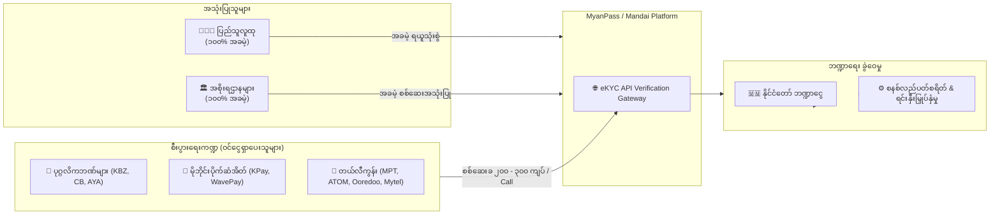

# Technical Writeup: MyanPass eKYC PPP Financial Model and 90-Day Pilot Roadmap

- **Project**: `personal/projects/myanpass/`
- **Date**: 2026-10-30
- **Model**: Public-Private Partnership (PPP) / Build-Operate-Transfer (BOT)

---

## ၁။ ဘဏ္ဍာရေး မော်ဒယ်နှင့် ရင်းနှီးမြှုပ်နှံမှု (PPP / BOT Financial Model)

အမျိုးသားအဆင့် ဒစ်ဂျစ်တယ်အိုင်ဒီစနစ် တည်ဆောက်ရာတွင် နိုင်ငံတော်ဘတ်ဂျက်မှ ငွေလုံးငွေရင်း သုံးစွဲရန် မလိုအပ်ဘဲ **PPP / BOT** ပုံစံဖြင့် အကောင်အထည်ဖော်မည်ဖြစ်သည်။

### ၁.၁။ အခမဲ့နှင့် အခပေး ဝန်ဆောင်မှု ခွဲခြားခြင်း
1. **အစိုးရဌာနများနှင့် ပြည်သူလူထု (၁၀၀% အခမဲ့)**:
   - ပြည်သူများ အက်ပ်ဒေါင်းလုဒ်လုပ်ခြင်း၊ မှတ်ပုံတင် ထည့်သွင်းခြင်း၊ အစိုးရရုံး အွန်လိုင်းဝန်ဆောင်မှု ရယူခြင်းများအတွက် ငွေတစ်ပြားတစ်ချပ်မျှ ကောက်ခံခြင်း မရှိပါ။
   - ရဲတပ်ဖွဲ့၊ ထွေ/အုပ်၊ လဝကနှင့် ဝန်ကြီးဌာနများ အချင်းချင်း ဒေတာစစ်ဆေးခြင်းများကို အခမဲ့ အသုံးပြုခွင့်ပေးမည်။
2. **စီးပွားရေးလုပ်ငန်းများအတွက် eKYC Micro-Fee ဝန်ဆောင်ခ**:
   - ပုဂ္ဂလိကဘဏ်များ၊ မိုဘိုင်းငွေကြေးများ (KPay, WavePay) နှင့် တယ်လီကွန်းကုမ္ပဏီများသည် အကောင့်အသစ်ဖွင့်ခြင်းနှင့် SIM ကတ် အတည်ပြုခြင်းများအတွက် အချက်အလက်မှန်ကန်ကြောင်း စစ်ဆေးရာတွင် **တစ်ကြိမ်လျှင် ၂၀၀ မှ ၃၀၀ ကျပ် (Micro-Fee)** ပေးချေရမည်။
   - ဘဏ်များအတွက် လက်ရှိ စာရွက်စာတမ်းစစ်ဆေးခြင်းထက် အချိန်နှင့် ငွေကြေး ကုန်ကျစရိတ် ၈၀% ပိုမို သက်သာစေပါသည်။

### ၁.၂။ ဝင်ငွေခန့်မှန်းချက် (Projected Revenue)
- မြန်မာနိုင်ငံတွင် ဘဏ်အကောင့်၊ မိုဘိုင်းပိုက်ဆံအိတ်နှင့် SIM ကတ် အတည်ပြုမှုသည် တစ်နှစ်လျှင် အကြိမ်ရေ သန်း ၅၀ မှ ၁၀၀ ကျော် ရှိသည်။
- ပျမ်းမျှ စစ်ဆေးခ ၂၅၀ ကျပ်ဖြင့် တွက်ချက်ပါက 一နှစ်လျှင် **ကျပ် ဘီလီယံ ၁၅ မှ ၂၅ ဘီလီယံခန့်** ပုံမှန် ဝင်ငွေစီးကြောင်း ရရှိမည်ဖြစ်ပြီး၊ နိုင်ငံတော်အတွက် အခွန်ဘဏ္ဍာငွေ တိုက်ရိုက်တိုးပွားစေမည် ဖြစ်သည်။

---

## ၂။ ရက် (၉၀) အမြန်အကောင်အထည်ဖော်ရေး လမ်းပြမြေပုံ (90-Day Fast-Track Roadmap)

နိုင်ငံတော်အဆင့် စီမံကိန်းများ နှစ်ချီကြာမြင့်ပြီး မပြီးပြတ်သည့် အဖြစ်မျိုးမဖြစ်စေရန် ရက်ပေါင်း ၉၀ အတွင်း လက်တွေ့အကျိုးရလဒ် ပေါ်ထွက်စေမည့် Fast-Track Pilot စီမံချက်ကို အောက်ပါအတိုင်း ချမှတ်ထားသည်—

| ကာလ (Timeline) | အဆင့် (Phase) | အဓိက ပြီးမြောက်ရမည့် ရလဒ်များ (Key Deliverables) |
| --- | --- | --- |
| **ရက် ၁ မှ ၃၀** | **အဆင့် ၁: လုံခြုံရေးအခြေခံနှင့် UID ချိတ်ဆက်ခြင်း** | - နေပြည်တော်/ရန်ကုန် Data Center တွင် HSM စက်များနှင့် National Root PKI တပ်ဆင်ခြင်း - လဝက UID API နှင့် Secure mTLS တံတား ချိတ်ဆက်ပြီး သဘောတူညီချက် စမ်းသပ်ခြင်း - စနစ်တစ်ခုလုံး၏ ISO/IEC 27001 လုံခြုံရေး မူဘောင် ချမှတ်ခြင်း |
| **ရက် ၃၁ မှ ၆၀** | **အဆင့် ၂: အက်ပ်များ တည်ဆောက်ခြင်းနှင့် စမ်းသပ်ခြင်း** | - ပြည်သူသုံး MyanPass App (iOS & Android) နှင့် FIDO2 Passkeys စနစ် အသက်သွင်းခြင်း - ရဲတပ်ဖွဲ့သုံး Enforcer App (Offline ECDSA Scanner) စမ်းသပ် အောင်မြင်ခြင်း - အကောင့်ဖွင့်သူများ၏ မျက်နှာကို Liveness Detection ဖြင့် စမ်းသပ်မှု ပြုလုပ်ခြင်း |
| **ရက် ၆၁ မှ ၉၀** | **အဆင့် ၃: မြေပြင် Pilot စတင်ခြင်းနှင့် လွှဲပြောင်းခြင်း** | - **မြန်မာနိုင်ငံ နိုင်ငံကူးလက်မှတ်ထုတ်ပေးရေးရုံး (Passport Office)** တွင် Online Appointment ကို ဤအက်ပ်ဖြင့် စတင် စမ်းသပ်ပြေးဆွဲခြင်း - ရန်ကုန်/မန္တလေး/နေပြည်တော်ရှိ **ရှေ့ပြေး မြို့နယ် (၅) ခု** တွင် ရဲတပ်ဖွဲ့နှင့် ထွေ/အုပ် စစ်ဆေးရေးဂိတ်များတွင် စတင် အသုံးပြုခြင်း - ပြည်ထောင်စုအဆင့် အောင်မြင်မှု အစီရင်ခံစာ တင်ပြပြီး တစ်နိုင်ငံလုံး တိုးချဲ့အသုံးပြုရန် ပြင်ဆင်ခြင်း |

---

## ၃။ အန္တရာယ်စီမံခန့်ခွဲမှု မူဘောင် (Risk Management Matrix)

| အန္တရာယ် ဖြစ်နိုင်ခြေ | သက်ရောက်မှု | ဖြေရှင်းချက် မဟာဗျူဟာ (Mitigation Strategy) |
| --- | --- | --- |
| **အင်တာနက်နှင့် လျှပ်စစ်မီး ပြတ်တောက်ခြင်း** | အလွန်မြင့်မား | Dynamic QR Payload ကို ECDSA လက်မှတ်ပါသော Offline QR အဖြစ် ဒီဇိုင်းထုတ်ထားပြီး Enforcer App တွင် National Public Key ကို Pre-load လုပ်ထားသဖြင့် အော့ဖ်လိုင်း ၁၀၀% အလုပ်လုပ်နိုင်သည်။ |
| **ဝန်ကြီးဌာနအချင်းချင်း ပူးပေါင်းဆောင်ရွက်မှု နှောင့်နှေးခြင်း** | အလယ်အလတ် | ပြည်ထဲရေး၊ လဝက၊ ပို့/ဆက် ဝန်ကြီးဌာနများပါဝင်သော အဆင့်မြင့် ပူးပေါင်းနည်းပညာလုပ်ငန်းအဖွဲ့ (Joint Task Force) ဖွဲ့စည်း၍ အပတ်စဉ် စောင့်ကြည့်စစ်ဆေးမည်။ |
| **ပြည်သူများ စမတ်ဖုန်း အဟောင်းများ သုံးစွဲခြင်း** | အလယ်အလတ် | Hardware Keystore မပါသော Android ဖုန်းအဟောင်းများအတွက် Fallback OTP နှင့် ရပ်ကွက်/မြို့နယ်ရုံးများတွင် Kiosk ကောင်တာများဖြင့် ဝန်ဆောင်မှုပေးမည်။ |
