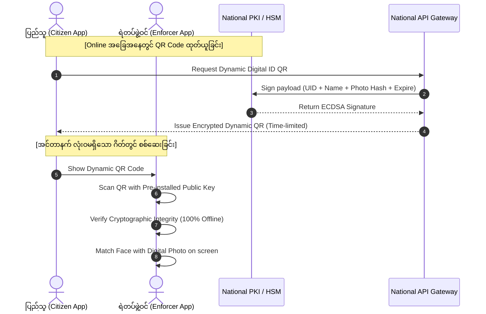

# Architecture Decision Record (ADR): National Digital Identity System Architecture

- **Project**: `personal/projects/myanpass/`
- **Date**: 2026-10-30
- **Status**: Accepted
- **Lead Architect**: Hein Htet Kyaw

---

## ၁။ Context & Problem Statement (ပြဿနာနှင့် နောက်ခံအခြေအနေ)

မြန်မာနိုင်ငံတွင် နိုင်ငံသားစိစစ်ရေးကတ်ပြား (NRC) များသည် စက္ကူနှင့် ပလတ်စတစ်ကတ်များ ဖြစ်သောကြောင့် စစ်ဆေးရေးဂိတ်များတွင် အတု/အစစ် ခွဲခြားရန် ခက်ခဲခြင်း၊ အကောင့်ပုန်းများနှင့် ငွေကြေးလိမ်လည်မှုများ ဖြစ်ပွားခြင်း၊ အစိုးရရုံးလုပ်ငန်းများတွင် ပွဲစားကြီးစိုးခြင်း စသည့် စိန်ခေါ်မှုကြီးများနှင့် ရင်ဆိုင်နေရသည်။

လူဝင်မှုကြီးကြပ်ရေးနှင့် ပြည်သူ့အင်အား ဝန်ကြီးဌာန (MOIP) မှ Unique Identification (UID) စနစ်နှင့် ဇီဝအချက်အလက် (Biometrics) များကို ကောက်ယူထားပြီး ဖြစ်သော်လည်း အဆိုပါဒေတာများကို ဝန်ကြီးဌာနများနှင့် ပြည်သူ့ဝန်ဆောင်မှုများသို့ တိုက်ရိုက်ချိတ်ဆက်ပေးနိုင်မည့် **အမျိုးသားအဆင့် ဒစ်ဂျစ်တယ်သက်သေခံစနစ် (National Digital Identity Platform)** မရှိသေးပါ။

ထို့အပြင် မြန်မာ့မြေပြင်အခြေအနေအရ လျှပ်စစ်မီးနှင့် အင်တာနက်လိုင်း ချို့ယွင်းမှုများ မကြာခဏ ဖြစ်ပွားလေ့ရှိရာ **Online သီးသန့်စနစ်သည် မြေပြင်တွင် မအောင်မြင်နိုင်ပါ။**

---

## ၂။ Decision & Core Architecture (ဗိသုကာ ရွေးချယ်မှုနှင့် ဆုံးဖြတ်ချက်များ)

### ၂.၁။ ဗဟိုချုပ်ကိုင်မှုမရှိသော ဒေတာဖလှယ်ရေးစနစ် (Federated API Gateway)
- **Monolith Database ကို ပယ်ဖျက်ခြင်း**: ဝန်ကြီးဌာနအားလုံး၏ ဒေတာများကို ဗဟို Database တစ်ခုတည်းတွင် စုပြုံသိမ်းဆည်းခြင်း (Centralized Honeypot) အစား **Federated Architecture** (Estonia X-Road / Singpass MyInfo ပုံစံ) ကို ရွေးချယ်သည်။
- **ဒေတာပိုင်ဆိုင်ခွင့်**: ဝန်ကြီးဌာနတစ်ခုချင်းစီသည် မိမိတို့၏ Database ကို သီးခြားလုံခြုံစွာ ဆက်လက်ထိန်းသိမ်းမည်။ MyanPass Gateway သည် ပြည်သူ၏ သဘောတူညီချက် (Consent) ရရှိမှသာ mTLS (Mutual TLS 1.3) နှင့် Tokenized OAuth 2.0 / OIDC မှတစ်ဆင့် အချက်အလက်များကို စက္ကန့်ပိုင်းအတွင်း လှမ်းယူပေးမည်။

### ၂.၂။ အင်တာနက်မလိုသော Cryptographic Offline QR စနစ်
- **Offline Proof of Identity**: နိုင်ငံသား၏ App ပေါ်တွင် ထုတ်ပေးသော QR Code သည် ရိုးရိုး URL မဟုတ်ဘဲ နိုင်ငံသား၏ အခြေခံဒေတာ (UID, Name, Photo, Expiry) ကို နိုင်ငံတော်အဆင့် Root CA ၏ Private Key ဖြင့် Cryptographically လက်မှတ်ထိုးထားသော Data Payload ဖြစ်သည်။
- **Cryptographic Standard**: **ECDSA (Elliptic Curve Digital Signature Algorithm) with Curve P-256** သို့မဟုတ် **Ed25519** ကို အသုံးပြုသည်။
- **Enforcer App Verification**: စစ်ဆေးရေးဂိတ်ရှိ ရဲတပ်ဖွဲ့သုံး Enforcer App တွင် National Public Key ကို Pre-installed ပြုလုပ်ထားသောကြောင့် အင်တာနက်မရှိသည့် လှိုဏ်ခေါင်း၊ တောတောင်နှင့် နယ်စပ်ဂိတ်များတွင်ပင် QR Code ကို စက္ကန့်မဆိုင်း စစ်ဆေးနိုင်မည်။

### ၂.၃။ Authentication & Security Infrastructure
- **FIDO2 / Passkeys**: စကားဝှက် (Password) အခြေပြု စနစ်များကို လုံးဝရှောင်ရှားပြီး ဖုန်း၏ Secure Enclave / Hardware Keystore နှင့် ချိတ်ဆက်ထားသော Passkeys များကိုသာ အသုံးပြုသည်။
- **Liveness Detection (Biometric Anti-Spoofing)**: မျက်နှာဓာတ်ပုံအတု၊ ဗီဒီယိုအတု (Deepfake) များဖြင့် လှည့်စား၍ မရစေရန် မျက်တောင်ခတ်ခြင်း၊ ခေါင်းလှုပ်ရှားခြင်းနှင့် 3D Depth Map ကို စစ်ဆေးသည့် AI Liveness Detection ကို ထည့်သွင်းသည်။
- **Hardware Security Modules (HSM)**: အမြင့်ဆုံး လုံခြုံရေးအဆင့် **FIPS 140-3 Level 3 HSM** စက်ကြီးများကို နေပြည်တော်နှင့် ရန်ကုန်ရှိ နိုင်ငံတော်ပိုင် Data Center နှစ်ခုတွင် တပ်ဆင်၍ Digital Signatures များနှင့် Root Certificates များကို ထိန်းသိမ်းသည်။

---

## ၃။ Rationale & Trade-offs (ရွေးချယ်မှုဆိုင်ရာ အကြောင်းပြချက်နှင့် အပေးအယူများ)

| နည်းပညာ ရွေးချယ်မှု | အားသာချက်များ (Pros) | အပေးအယူ / စိန်ခေါ်မှုများ (Trade-offs) |
| --- | --- | --- |
| **Federated API Gateway** | ဝန်ကြီးဌာနအချင်းချင်း အာဏာစက်မထိခိုက်၊ ဒေတာပေါက်ကြားမှုအန္တရာယ် အလွန်နည်းပါး | ဝန်ကြီးဌာနတစ်ခုချင်းစီတွင် API Adapter များ ရေးဆွဲတပ်ဆင်ရန် လိုအပ် |
| **Offline ECDSA QR** | အင်တာနက်လိုင်းလုံးဝမရှိသည့် နေရာများတွင် ၁၀၀% စစ်ဆေးနိုင် | Dynamic QR သက်တမ်း ကုန်ဆုံးပါက Refresh လုပ်ရန် အင်တာနက် ခေတ္တလိုအပ် |
| **FIDO2 Passkeys** | Phishing နှင့် စကားဝှက်ခိုးယူခံရမှု ၁၀၀% ကာကွယ်နိုင် | ဖုန်းအဟောင်းများ (Android Go စသည်) အတွက် SMS OTP / Backup Kiosk စနစ် စီစဉ်ပေးရမည် |

---

## ၄။ ဥပဒေနှင့် ကိုယ်ရေးလုံခြုံမှု အကာအကွယ် (Privacy & Compliance)

1. **Zero Raw Biometric Storage on Phone**: ပြည်သူ့ဖုန်းထဲတွင် Fingerprint သို့မဟုတ် Face Raw Data မသိမ်းဘဲ Template Hash ကိုသာ စစ်ဆေးသည်။
2. **Explicit Consent & Purpose Binding**: ပြည်သူ၏ App မှ သဘောတူခွင့်ပြုချက် မပေးဘဲ မည်သည့်ဘဏ်၊ တယ်လီကွန်း သို့မဟုတ် ဌာနကမျှ အချက်အလက် ကြည့်ရှုခွင့်မရှိစေရ။
3. **Immutable Audit Trail**: မည်သူက မည်သည့်အချိန်တွင် အချက်အလက် ရယူသွားသည်ကို ပြည်သူကိုယ်တိုင် App ထဲတွင် ၂၄ နာရီ ပြန်လည်စစ်ဆေးနိုင်သော Access Log စနစ် ထည့်သွင်းထားသည်။
