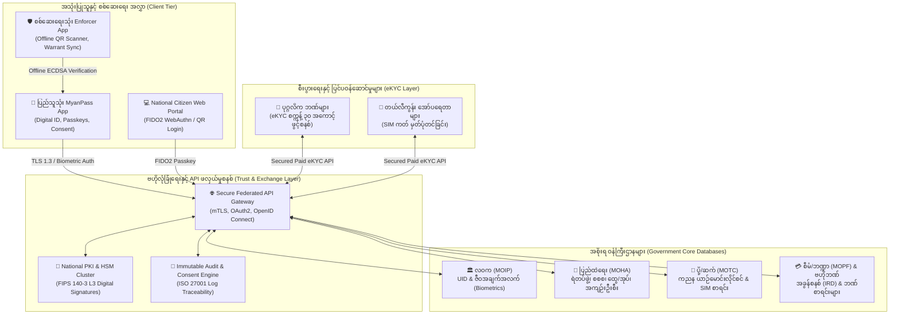

# MyanPass (မဏ္ဍိုင် / MANDAI) — အမျိုးသားဒစ်ဂျစ်တယ်အိုင်ဒီစနစ်

- **Project Path**: `~/github/h2kyaw/myanpass`
- **GitHub Repository**: [h2kyaw/myanpass](https://github.com/h2kyaw/myanpass)
- **Knowledge Base Location**: `personal/projects/myanpass/`
- **Domain**: National Digital Identity (NDI) & Government eServices Platform
- **Benchmark**: Singapore Singpass / Estonia X-Road (Adapted for Myanmar infrastructure)
- **Status**: Architectural Planning & Tender Proposal Ready

---

## ၁။ စနစ်ဗိသုကာ ခြုံငုံသုံးသပ်ချက် (System Architecture)

---

## ၂။ မဟာဗျူဟာ မဏ္ဍိုင်ကြီး (၃) ရပ်

1. **နိုင်ငံတော်လုံခြုံရေး (National Security)**:
   - မှတ်ပုံတင်အတု၊ ထောက်ခံစာအတုနှင့် ဆင်းမ်ကတ်/ဘဏ်အကောင့်ပုန်း (Money Mule) များကို ဒစ်ဂျစ်တယ် လက်မှတ်နှင့် ဇီဝအချက်အလက်ဖြင့် အမြစ်ပြတ် တိုက်ဖျက်ခြင်း။
   - အင်တာနက်မရှိသော နယ်စပ်နှင့် စစ်ဆေးရေးဂိတ်များတွင် Offline QR ဖြင့် ချက်ချင်း စစ်ဆေးနိုင်ခြင်း။
2. **ခေတ်မီအုပ်ချုပ်ရေးယန္တရား (Modern Governance)**:
   - ဝန်ကြီးဌာနအချင်းချင်းကြား စာရွက်စာတမ်းမလိုဘဲ စက္ကန့်ပိုင်းအတွင်း ဒေတာဖလှယ်နိုင်ခြင်း (Paperless Governance)။
   - ပတ်စ်ပို့နှင့် အစိုးရရုံး အွန်လိုင်းရက်ချိန်းများတွင် ကြားခံပွဲစားနှင့် Bot များ လက်ဝါးကြီးအုပ်မှုကို ၁၀၀% ကာကွယ်ခြင်း။
3. **ပြည်သူ့ဘဝ သက်သာလွယ်ကူရေး (Citizen Convenience)**:
   - ဖုန်းတစ်လုံးရှိရုံဖြင့် မှတ်ပုံတင်၊ ယာဉ်မောင်းလိုင်စင်၊ ဧည့်စာရင်းနှင့် အခွန်ဆောင်ခြင်းတို့ကို ရုံးတန်းစီစရာမလိုဘဲ အိမ်မှနေ၍ ၅ မိနစ်အတွင်း ဆောင်ရွက်နိုင်ခြင်း။

---

## ၄။ စီမံကိန်းအဖွဲ့နှင့် ပူးပေါင်းဆောင်ရွက်သူများ (Core Team & Collaborators)

| အမည် | GitHub | အခန်းကဏ္ဍ (Role) |
| :--- | :--- | :--- |
| **Hein Htet Kyaw** | [@h2kyaw](https://github.com/h2kyaw) | Project Lead & System Architect |
| **Htet Myet** | [@htetmyetnaing98](https://github.com/htetmyetnaing98) | Co-Founder & Technical Collaborator |

---

## ၅။ အဓိက မှတ်တမ်းများနှင့် နည်းပညာစာရွက်စာတမ်းများ (Documents Index)

| ဖိုင်အမည် | အမျိုးအစား | အကြောင်းအရာ အကျဉ်းချုပ် |
| --- | --- | --- |
| [2026-10-30-national-digital-identity-architecture.md](./2026-10-30-national-digital-identity-architecture.md) | Architecture ADR | Federated API, National PKI, FIDO2, Offline ECDSA QR စနစ်ဗိသုကာ |
| [2026-10-30-moha-tender-proposal-and-slides.md](./2026-10-30-moha-tender-proposal-and-slides.md) | Tender & Slides | ပြည်ထဲရေးဝန်ကြီးဌာန တင်ဒါအဆိုပြုလွှာ၊ Slide (၁၀/၁၂) ခု အပြည့်အစုံနှင့် Speaker Scripts |
| [2026-10-30-ekyc-ppp-financial-model-and-roadmap.md](./2026-10-30-ekyc-ppp-financial-model-and-roadmap.md) | Business & Roadmap | ဘတ်ဂျက်မလိုသော PPP/BOT စီးပွားရေးမော်ဒယ်၊ eKYC API အခကြေးငွေနှင့် ရက် ၉၀ Pilot စီမံချက် |
| [gemini-discussion-archive.md](./gemini-discussion-archive.md) | Discussion Archive | Gemini နှင့် ပြုလုပ်ခဲ့သော မူရင်း အမေးအဖြေ (၈) ကြိမ်လုံး၏ Markdown မှတ်တမ်းအပြည့်အစုံ |
